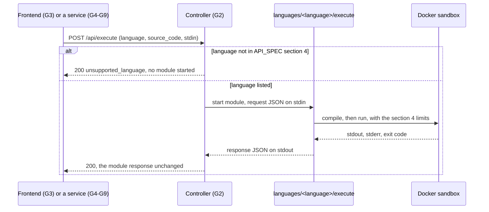

# Execution Controller and Language Selection: Design

**Owner:** Group 2
**Status:** Draft for review by Group 2, then by Group 1 (contract), Group 3 (frontend) and Group 7 (integration)
**Follows:** [API_SPEC.md](../API_SPEC.md) v1.0. Where this document and the spec disagree, the spec wins.

## 1. What it is and why

Everything that runs code in MPLab goes through one door: `POST /api/execute`. That includes the student editor (Group 3) and the lecturer, assessment, submissions, diagnostics and comparison services (Groups 4, 5, 6, 8 and 9). The controller is that door. It does three jobs:

1. **Routing:** read `language`, reject anything outside API_SPEC §4 with `unsupported_language`, and hand everything else to the matching module in `languages/<language>/`.
2. **Protecting the platform:** validate requests at the boundary, cap how many programs run at once, and turn a broken or hung module into a clean `internal_error`, so one bad module cannot take the site down.
3. **Language selection:** tell callers which ten languages exist, in what order, under what display names, and which are connected yet (`GET /api/languages`). The frontend's language picker and the lecturer's "required language" field are built from this list.

The controller never compiles or runs submitted code itself. Each module does that inside its own sandbox, as the brief requires (§9: no submitted code inside the web application process).

Success looks like this: in the Week 8 demo the lecturer picks any of the ten languages, runs good and broken programs, and every result comes back in the spec format through this one endpoint. Every Group 2 member can then walk through the code that did it.

## 2. Goals, non-goals, anti-goals

**Goals**
- Serve `POST /api/execute` exactly as API_SPEC §1–4 defines it.
- Answer `unsupported_language` itself, without starting any module.
- Return the module's response **unchanged** for every listed language.
- Serve `GET /api/languages` for language selection.
- Fix the module invocation contract that Group 7's README leaves to Group 2 (§5.4).
- Ship as one Rust binary that needs no language runtime on the VM, with code small enough for every member to explain.
- Let a group connect its module with a PR to its own folder only, with no controller change, rebuild or restart.

**Non-goals** (other groups own these, or nobody asked for them)
- Running or sandboxing code. Modules own this (brief Task C).
- Enforcing the compile/run/memory/output limits. Modules own this. The controller only has a backstop for modules that hang.
- Storing submissions or results (Group 6), running test cases in batches (Group 5), or turning errors into diagnostics (Group 8).
- Authentication. The brief puts it out of scope (§5).
- Compiling once and running many test cases, a batch endpoint, starter code templates per language, compiler version strings, a health endpoint, and graceful shutdown. None of these is needed now. Add one when a group asks for it.

**Anti-goals** (failures even if the endpoint "works")
- Running submitted code in the controller process or on the host outside a sandbox.
- Rewriting or "fixing up" a module's response. That would hide module bugs that Group 7's tests should catch.
- Requiring other groups to restructure working modules to fit the controller. (A two-line `execute` launcher, §5.4, is not a restructure.)
- Any per-language special case inside the controller beyond its entry in the §4 language list.

## 3. Constraints

From API_SPEC v1.0:
- Request `{language, source_code, stdin}` with `stdin` defaulting to `""`. Response `{status, stdout, stderr, exit_code, execution_time_ms}`.
- Six statuses only: `success`, `compile_error`, `runtime_error`, `timeout`, `unsupported_language`, `internal_error`. `exit_code` and `execution_time_ms` are `null` for `unsupported_language` and `internal_error`.
- `language` is matched exactly and is case-sensitive: `c cpp java python javascript go ruby php haskell prolog`. `"Python"` is unsupported.
- Limits: compile 10 s, run 5 s, 256 MB, 64 KB output, no network. A module that does a compile, a run and two Docker container starts can legitimately take about 17 s.

From the brief and the repo:
- Brief Task C makes each group build its own module: receive the code, invoke the compiler or interpreter, run it, capture output, return a status, and enforce limits through the sandbox. That module is 25% of each group's marks, so the controller must not take that work away.
- It deploys to an FSKTM Linux VM. It targets POSIX systems only (Linux, macOS, WSL), because the backstop kills a whole process group. Windows developers use WSL. Faculty IT controls the machine, and routine deployment must not use unrestricted administrator privileges (§9).
- `controller/` is a shared folder, so every PR needs a reviewer from another group. The repo is public, so no VM addresses or logins go in it.
- The only module so far (Group 7, Ruby, unmerged branch `group7/ruby-executor`) is a script that reads one JSON request on stdin, writes one JSON response on stdout, and runs the program in a throwaway Docker container. It is evidence that the stdin/stdout shape works, not a reason on its own to adopt it.

## 4. Approaches considered

Each decision below was judged on its merits for ten groups writing modules in ten different toolchains. Where the chosen option happens to match Group 7's module, that is a bonus, not the reason.

### Decision 1: how the controller talks to a module

| | Option | Trade-off |
|---|---|---|
| **A (chosen)** | **Start the module as a subprocess per request. The request JSON goes in on stdin and the response JSON comes back on stdout.** | Each request gets a fresh process, so a module that crashes, leaks memory or hangs hurts only that request, and the controller can always kill it. A module can be written in any language, which suits a course on language paradigms. No ports, no extra services, no shared state. Stdin has no length or escaping limits, unlike command-line arguments. Starting a process costs milliseconds, which is nothing next to a Docker container start (about 0.5–1 s). |
| B | Each module runs as its own long-lived HTTP service | Modules could keep warm state, such as a pre-started container pool. The cost is ten extra services to deploy, assign ports to, restart and monitor on a VM Faculty IT controls, and a hung or leaking module now degrades every later request instead of one. The warm-state gain is small while each run starts a fresh container anyway. |
| C | The controller runs the sandbox itself, and modules supply only a Docker image plus compile and run commands | Technically the cleanest: one place enforces limits, exit codes and timing the same way for everyone. Rejected because it moves Task C (invoking the compiler, running, capturing output, enforcing limits) out of each group's module and into ours, which takes away the work each group is marked on. |

### Decision 2: how the controller finds a module

| | Option | Trade-off |
|---|---|---|
| **A (chosen)** | **A fixed path in every module: `languages/<language>/execute`, an executable file.** | The controller has no module table at all. A group connects its module by merging its own folder, which its own group can approve, and it is live on the next `git pull` with no controller rebuild or restart. `GET /api/languages` reports what is really on disk. The cost is that every module adds a small launcher (§5.4) and must commit it with the execute bit set. The controller checks for a missing execute bit and reports it by name, so the mistake is not silent. |
| B | A table in the controller mapping each language to a command | Explicit, and Group 7's script would work without a launcher. The cost is that every module connection becomes a PR to the shared `controller/` folder needing a cross-group reviewer, and with a compiled controller it also needs a rebuild and a restart on the VM. Ten modules arriving over Weeks 3–5 means ten of those cycles. |
| C | A config file (`controller/modules.json`) read at startup | Avoids the rebuild of B, but keeps the shared-folder PR and the restart, and adds a file format to document. |

### Decision 3: what the controller is built with

The controller is written in **Rust**. This was Group 2's call. What it buys and what it costs:

- **Gains:** one self-contained binary, so the VM needs no Python, Node or JVM for the controller; the compiler checks that every response has the spec's five fields and the `status` enum; there are no data races under concurrent requests; and Group 2 gets a second paradigm to write about in the technical report.
- **Costs:** a build step (`cargo build`), a slower first compile, and a steeper learning curve. Every member must be able to explain the code at the Week 8 demo, so the logic stays in one file (`src/lib.rs`) and avoids writing its own traits, generics or macros.

Within Rust:

| | Option | Trade-off |
|---|---|---|
| **A (chosen)** | **`axum` on `tokio`, with `tokio::process` for modules** | The mainstream Rust web stack, with the most documentation and examples. `tokio` gives async child processes with piped stdin/stdout, timeouts (`tokio::time::timeout`) and a semaphore (`tokio::sync::Semaphore`) out of the box, so a request waiting on a 17 s module costs a task, not a thread. The cost is async Rust, which members need to learn to the level of `async fn` and `.await`. |
| B | `tiny_http` with `std::thread` and `std::process` | No async, so it is easier to read. But `std` has no wait-with-timeout and no semaphore, so we would hand-write both, plus a thread per pipe to avoid deadlocks. More code that is ours to get right. `tiny_http` is also lightly maintained. |
| C | `actix-web` | Comparable to A. No advantage here, and less common in current examples. |

## 5. Design

### 5.1 Where it sits



On the VM, nginx serves the frontend and passes `/api/` to the controller on `127.0.0.1`. Services on the same VM may call `http://127.0.0.1:<port>/api/execute` directly.

### 5.2 Endpoints

**`POST /api/execute`**: exactly as in API_SPEC §1–3.

**`GET /api/languages`**: the ten languages in API_SPEC §4 order. `available` is `true` when `languages/<value>/execute` exists and is executable. It is checked on each request, so a newly merged module shows up without a restart.

```json
[
  {"value": "c",      "name": "C",      "available": false},
  {"value": "cpp",    "name": "C++",    "available": false},
  ...
  {"value": "ruby",   "name": "Ruby",   "available": true},
  ...
  {"value": "prolog", "name": "Prolog", "available": false}
]
```

During Weeks 4–5, while modules are still arriving, the frontend can grey out languages that aren't connected yet instead of letting students hit errors.

**`OPTIONS`** on both paths answers CORS preflight requests. Every response carries `Access-Control-Allow-Origin: *`, which lets Group 3 develop the frontend on a different port. Allowing every origin is fine here: there are no cookies and no login.

Any other path returns 404.

### 5.3 What happens to one `POST /api/execute`

The handler takes the body as raw bytes and parses it itself, rather than using axum's `Json` extractor, so that the order of checks below is ours and every rejection has the spec shape.

1. **Size:** if the body is over 1 MB, answer **413**. (`DefaultBodyLimit::max`, with the extractor's rejection mapped to the spec shape.)
2. **Parse:** decode the body as UTF-8 JSON into a `serde_json::Value`. If it doesn't decode, or isn't a JSON object, answer **400**.
3. **Language:** if `language` isn't one of the ten exact strings, answer **200** `unsupported_language` without starting anything. That covers a missing value, a wrong case, a non-string and an unknown name. `stderr` lists the accepted values, which helps callers debug. Because only these ten fixed strings ever reach the next steps, `language` can't be used to build a path outside `languages/`.
4. **Fields:** `source_code` must be a string (an empty string is allowed, and the module decides what it means). If `stdin` is missing or `null` it becomes `""`. Any other non-string `source_code` or `stdin` gets **400**.
5. **Connected?** If `languages/<language>/execute` doesn't exist, answer **200** `internal_error` with `"The <Name> module is not connected to MPLab yet."` If it exists but isn't executable, answer **200** `internal_error` with `"The <Name> module's execute file is not executable."`
6. **Slot:** wait up to 30 s for one of `MPLAB_MAX_CONCURRENT` semaphore permits. If none frees up, answer **503** `internal_error` with `"MPLab is busy, try again."`
7. **Run the module** in a spawned task that owns the permit (see below). Start `languages/<language>/execute` in a new process group, with the repo root as the working directory. Write `{"language", "source_code", "stdin"}` to its stdin (with `stdin` already defaulted) and close it, while reading stdout and stderr at the same time so a chatty module can't deadlock on a full pipe. Wait up to the **30 s backstop**.
8. **Check the answer** (see the next part) and return it with **200**. Release the permit and write one log line.

**Why a spawned task.** If the caller disconnects, axum drops the request's future. A module started inside that future would lose its timeout and its cleanup. Running it in `tokio::spawn` and awaiting the join handle means the module always runs to completion or to the backstop, and the permit is always released.

**Checking the module's answer.** Parse stdout as JSON with `serde_json::from_slice`, which also rejects invalid UTF-8. It passes if it is an object whose `status` is one of the six values and which has all five fields. If it passes, return the module's stdout bytes **unchanged** as the body, with `Content-Type: application/json`, including any extra fields. The parse is only a check. Re-serialising a `serde_json::Value` would reorder keys, because it sorts them by default. Otherwise answer **200** `internal_error` with `"The <Name> module failed: <reason>"`. The reason is one of: did not answer within 30 s, exited with code N, was killed by signal N, returned invalid JSON, returned an unknown status, is missing field X, or could not be started. The module's own stderr goes to the log, never to the user, because it can contain host paths.

**On the backstop timeout,** kill the module's whole process group (`Command::process_group(0)` at spawn, then `nix::sys::signal::killpg` with `SIGKILL`), then reap the child so no zombie is left. Killing only the direct child (which is all `kill_on_drop` does) would leave its `docker run` client behind. The container itself belongs to the Docker daemon and can outlive this kill. That is why §5.4 asks modules to name containers `mplab-…`, so a sweep can find strays (§7).

**Every error the controller writes itself** (400, 413, 503, 404, `internal_error`, `unsupported_language`) has the full spec shape: `stdout: ""`, the message in `stderr`, and `exit_code` and `execution_time_ms` both `null`. A caller that ignores HTTP codes and only reads `status` still works.

**HTTP status codes in one rule:** 200 whenever the controller answered a well-formed request, whatever `status` says. A non-200 code means the request itself was rejected (400, 404, 413) or the server is full (503, safe to retry).

### 5.4 The module contract

This is what every `languages/<language>/` module must do to plug in.

1. **Entry point.** The module has an executable file at `languages/<language>/execute`, committed with the execute bit set (`git add --chmod=+x languages/<language>/execute` works from any OS). Usually it is a two-line launcher for the real executor, for example Group 7's would be:
   ```sh
   #!/bin/sh
   exec ruby "$(dirname "$0")/executor.rb"
   ```
   It can equally be a compiled binary or a script in any language with a shebang.
2. **Input.** One JSON object arrives on stdin, then EOF: `{"language": "<its own value>", "source_code": "...", "stdin": "..."}`. All three fields are always present and are strings. The working directory is the repo root.
3. **Output.** One JSON object on stdout in the API_SPEC §2/§3 format, encoded as UTF-8, followed by exit code 0. A trailing newline is fine. Nothing else goes on stdout.
4. **Its own stderr** is for the module's debugging. The controller logs it and doesn't show it to users. The submitted program's stderr belongs in the response's `stderr` field.
5. **Limits.** The module enforces every API_SPEC §4 limit inside its sandbox and answers within 30 s in total. Past 30 s the controller kills it and reports `internal_error`.
6. **Concurrency.** Many copies run at the same time, so the module uses unique temp files and container names. Container names start with `mplab-` (Group 7 already uses `mplab-compile-…` and `mplab-run-…`).
7. **Clean up.** The module leaves no files, containers or state behind and writes nothing into the repo.
8. **Host requirements.** The module README lists what the VM needs to run the executor itself, such as Ruby for Group 7's script, plus the Docker image tag and its build command.

### 5.5 The one table in the code

```rust
// API_SPEC section 4, in order. Drives validation and GET /api/languages.
const LANGUAGES: [(&str, &str); 10] = [
    ("c", "C"), ("cpp", "C++"), ("java", "Java"), ("python", "Python"),
    ("javascript", "JavaScript"), ("go", "Go"), ("ruby", "Ruby"),
    ("php", "PHP"), ("haskell", "Haskell"), ("prolog", "Prolog"),
];
```

There is no module table: a module's path is always `languages/<value>/execute` under the repo root. `LANGUAGES` changes only if API_SPEC §4 changes, and that goes through Group 1.

### 5.6 Concurrency

The `tokio` multi-threaded runtime runs each request as a task. A `tokio::sync::Semaphore` with `MPLAB_MAX_CONCURRENT` permits limits how many modules run at once. The default is `std::thread::available_parallelism()`, because every sandbox gets `--cpus=1` and 256 MB. The wait for a permit (30 s) and the backstop (30 s) are separate, so a caller can wait about 60 s in the worst case. Callers should set their HTTP client timeout to at least 65 s, and nginx's `proxy_read_timeout` to 70 s.

### 5.7 Logging

Each `POST /api/execute` writes one JSON line to stderr (`eprintln!` of a `serde_json::json!` value, no logging framework), which systemd sends to the journal. The line has the time, `language`, `status`, the HTTP code, total wall-clock ms and the size of `source_code` in bytes. When a module fails it also has the failure reason and the last 2 KB of the module's stderr. Source code and stdin are never logged: they are student work, and they would bloat the log. Group 8 (diagnostics) can read these lines. Confirm with them whether they need more fields.

### 5.8 Configuration

| Variable | Default | Why it's configurable |
|---|---|---|
| `MPLAB_PORT` | `8000` | The VM may already have something on 8000 |
| `MPLAB_MAX_CONCURRENT` | `available_parallelism()` | Gets tuned to the VM's CPU and memory without a code PR |
| `MPLAB_ROOT` | the current directory | The repo root that holds `languages/`. Tests point it at a temp folder of fake modules |

The bind address is fixed at `127.0.0.1`, so the controller is only reachable through nginx or from the VM itself. The 1 MB body cap and the 30 s waits are constants in the code; the router is built from a config struct so tests can shorten the waits.

### 5.9 Files and dependencies

| File | Contents |
|---|---|
| `controller/Cargo.toml` | Package `mplab-controller`, with `rust-version` set to the minimum Rust we test on |
| `controller/Cargo.lock` | Committed, so the VM builds exactly what was tested |
| `controller/src/lib.rs` | The whole controller: the router, the checks and running modules |
| `controller/src/main.rs` | Reads the environment (§5.8) and starts the server. Separate from `lib.rs` only because `tests/` can import a library but not a binary |
| `controller/tests/api.rs` | Tests (§6) using fake modules, so no Docker is needed |
| `controller/README.md` | How to build and run it, the endpoints with `curl` examples, the module contract (§5.4) and how to connect a module |
| `controller/DESIGN.md` | This document |

Dependencies, each for one job: `axum` (HTTP), `tokio` (runtime, processes, timeouts, semaphore), `serde_json` (JSON, used as untyped `Value`s, so no `serde` derive is needed), `tower-http` (CORS layer), `nix` with the `signal` feature (`killpg`, without `unsafe`). Dev-only: `tower` (to call the router in tests), `http-body-util` (to read response bodies) and `tempfile` (fake module folders).

## 6. Testing

**Controller tests** (`cargo test`). Each test builds the real router with a config pointing `MPLAB_ROOT` at a temp folder, and sends requests to it with `tower::ServiceExt::oneshot`, so no port or HTTP client is needed. Fake modules are small `#!/bin/sh` `execute` scripts written into that folder, so the tests need no Docker and run in seconds.

1. `"Python"`, `"rust"`, `""`, a missing `language` and `42` each give `unsupported_language`, and no module process is started (the fake module writes a marker file if it runs).
2. A listed language reaches its module, and the module's response comes back unchanged, including an extra field and key order.
3. The module receives exactly `{language, source_code, stdin}`, with `stdin` set to `""` when it was missing or `null`, and runs with `MPLAB_ROOT` as its working directory.
4. Invalid JSON, a JSON array, a missing `source_code` and a numeric `stdin` each give 400 in the spec shape.
5. A body over 1 MB gives 413 in the spec shape.
6. Each module failure gives 200 `internal_error`: a non-zero exit, non-JSON output, a missing field, an unknown status, and a hang past the backstop (shortened for the test). The hang test's fake module starts a child `sleep`, and the test checks that the child is gone too (process group kill).
7. A listed language with no `execute` gives `internal_error` "not connected", and one with `execute` lacking the execute bit gives "not executable". `GET /api/languages` shows `available: false` for both.
8. `GET /api/languages` returns all ten languages in §4 order.
9. `OPTIONS` returns the CORS headers, and every response, including 404, carries `Access-Control-Allow-Origin`.
10. With `MPLAB_MAX_CONCURRENT=1` and a slow fake module, a second request gets 503 (with the permit wait shortened for the test).

**Integration tests** need real modules and Docker. Agree with Group 7 whether they live in `tests/`. Through the controller, each connected language runs a hello-world, a compile or syntax error, a runtime error and an infinite loop, and the test checks for `success`, `compile_error`, `runtime_error` and `timeout`. On the VM, also send 20 requests at once, and cancel a few mid-run. Every request must get an answer, and `docker ps -a --filter name=mplab-` must be empty afterwards.

## 7. Deployment on the VM

Group 10 coordinates deployment and Faculty IT approves it. The controller needs:

- **A Rust toolchain for the service user, installed with `rustup` into their home directory.** This needs no administrator rights. Build with `cargo build --release --locked` from `controller/`. If Faculty IT won't allow a toolchain on the VM, build a static binary elsewhere (`--target x86_64-unknown-linux-musl`) and copy it over; nothing else changes.
- **Docker, plus whatever each executor needs**, such as Ruby for Group 7's script, and each module's image built in advance.
- **A systemd service** running as an unprivileged user (for example `mplab`), with `WorkingDirectory` set to the repo checkout, `ExecStart` pointing at `controller/target/release/mplab-controller`, and `Restart=on-failure`. Keep the default `KillMode=control-group`: modules run in their own process groups, but they stay in the service's cgroup, so stopping the service still stops them.
- **Updating:** `git pull`. A module change is live immediately. A controller change also needs `cargo build --release --locked` and `systemctl restart`.
- **nginx** serving the frontend and passing `/api/` to `127.0.0.1:$MPLAB_PORT`, with `client_max_body_size 1m` and `proxy_read_timeout 70s`.
- **The controller runs directly on the VM, not inside a container.** Modules mount host temp-file paths into their sandboxes, and those paths would not exist if the controller and the modules ran in a container talking to the host's Docker socket.
- **Rootless Docker for the service user, if Faculty IT allows it.** Membership of the `docker` group is equivalent to root. That runs into the brief's rule against unrestricted administrator privileges.
- **A periodic sweep** that removes `mplab-` containers older than about a minute. This catches strays left by a backstop kill or a crash. Group 10 owns this, with Group 2's input.

## 8. Milestones

| Week | Controller work |
|---|---|
| 3 | `lib.rs` and `cargo test` passing. Ruby connected once Group 7 adds `execute`, and C++ once Group 2's module runs. PR `G2: Add execution controller`, with a Group 7 reviewer |
| 4 | Group 3's editor calls both endpoints during local development (CORS). The C++ module demo goes through the controller |
| 5 | Each module connects itself by merging its `execute`. The controller runs on the VM behind nginx under systemd |
| 6 | Groups 5 and 6 call `/api/execute` from their services. Watch concurrency under assessment load and tune `MPLAB_MAX_CONCURRENT` |
| 7 | Test report: `cargo test` results, the ten-language integration results and the 20-request parallel check |
| 8 | Live demo. Every member can trace one request through `lib.rs` |

## 9. To agree with other groups

Most important first:

1. **All module groups:** the module contract in §5.4, in particular the `languages/<language>/execute` entry point. **Group 7** specifically: add the two-line launcher to `group7/ruby-executor` (or let Group 2 open that PR with their agreement).
2. **Group 1 (spec):** add `GET /api/languages` to API_SPEC, together with the module contract in §5.4 (it fits under §5.2). Confirm the HTTP status code rule in §5.3 and the 1 MB request cap, since the spec covers neither. Confirm that `internal_error` is the right status for a malformed request. Agree one convention for programs killed by a signal. We propose 128 + the signal number, which is what Docker reports: a segfault gives 139 and an out-of-memory kill gives 137.
3. **Group 3 (frontend):** confirm they want `GET /api/languages` in this shape and will build the language picker from it. Choose between serving from the same origin through nginx in production and cross-origin development with CORS. Set the client timeout to at least 65 s.
4. **Group 7 (integration):** review the controller PR, and decide where the integration tests in §6 live.
5. **Group 10 (deployment):** the §7 checklist, especially the user-level Rust toolchain (or the copied binary), rootless Docker and the stray-container sweep.
6. **Group 5 (assessment):** there is one execute call per test case and no batch endpoint. Calls queue for a slot when the server is busy, and a 503 is safe to retry.

## 10. Left to the builder

The exact wording of error messages, the function layout inside `lib.rs`, the test helper mechanics, the log field names beyond those listed in §5.7, and the README wording.

## 11. Calls made in this document

These are Group 2's choices. Nobody else has agreed to them yet.

- Rust with `axum` and `tokio`, over Python, Node, Go and the other Rust options (Decision 3).
- Modules are found at the fixed path `languages/<language>/execute`, not through a table in the controller (Decision 2).
- Modules stay one subprocess per request over stdin/stdout, not long-lived services, and not a controller-owned sandbox (Decision 1).
- A language-name check comes before field validation, so `{"language": "rust"}` with no code gives `unsupported_language`, not 400.
- A malformed request gets HTTP 400 with `status: internal_error`, because the spec has no "bad request" status.
- A listed language whose module isn't connected yet gives `internal_error`, not `unsupported_language`, because the spec defines unsupported as "not in the Section 4 list".
- The 30 s backstop, the 30 s permit wait, the 1 MB body cap and the concurrency default of one slot per CPU.
- `unsupported_language` carries a helpful message in `stderr`. The spec neither requires nor forbids this.
- The controller does not cap how much a module writes to stdout. Modules are reviewed code that already cut output at 64 KB. Add a cap if a module ever misbehaves.
